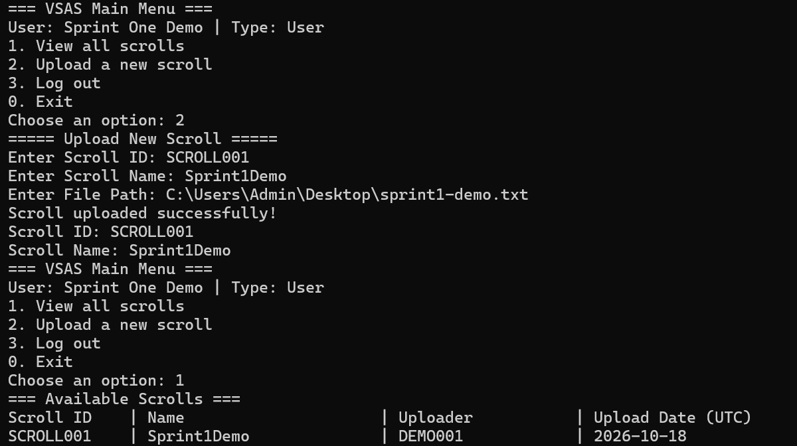
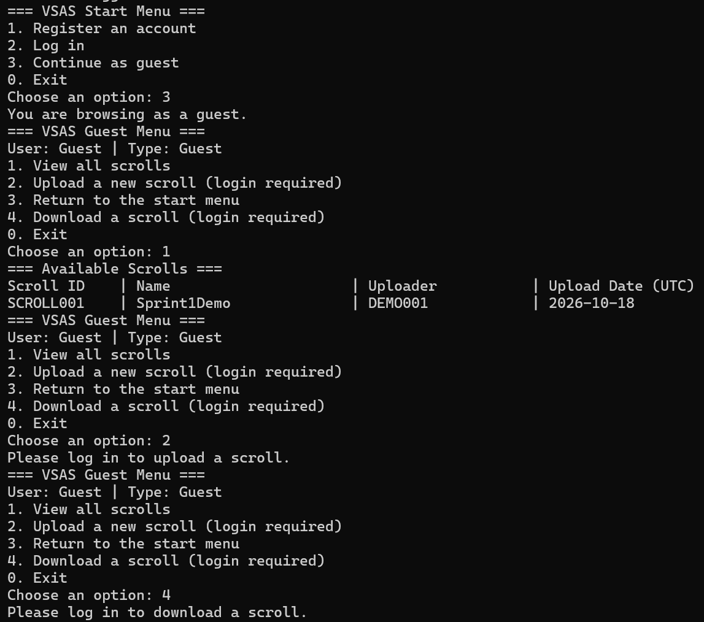
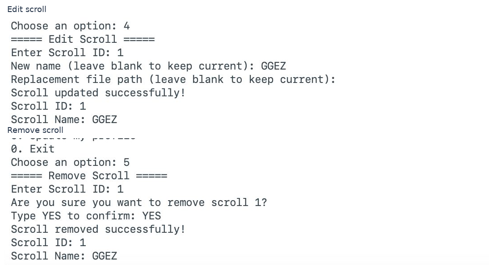
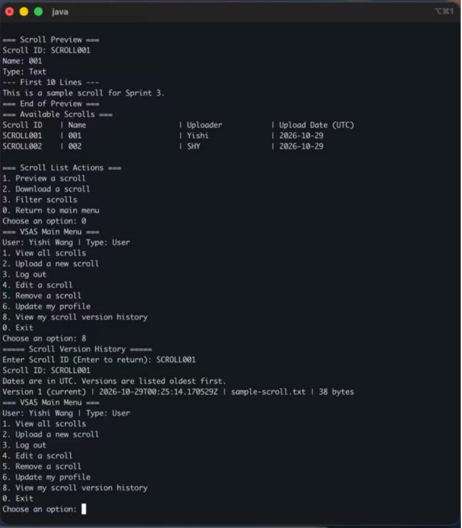
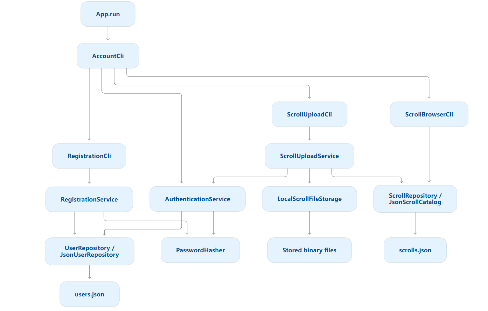
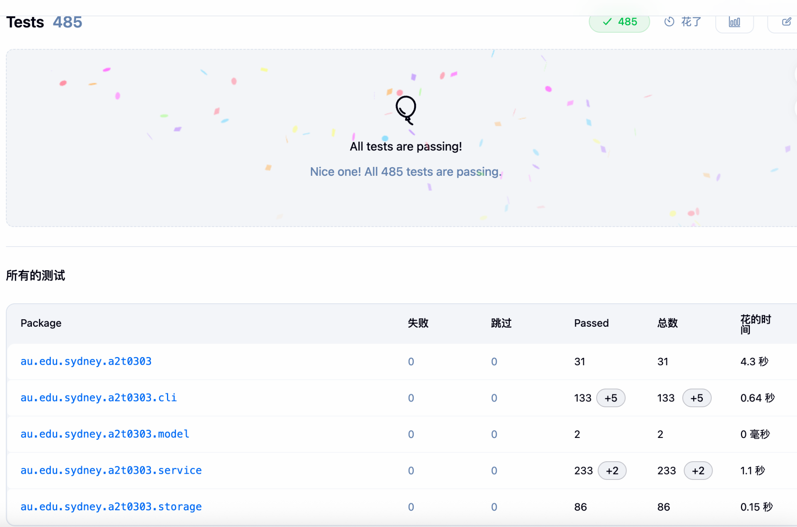
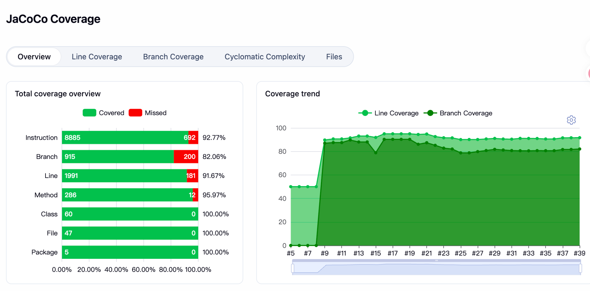

# VSAS — Virtual Scroll Access System

**Java 21 CLI application · University of Sydney, SOFT2412 · October 2026 · Four-person team project**

VSAS is a terminal-based digital file ("scroll") management application developed through three Scrum sprints. It supports account and role management, file operations, search and previews, history, encryption at rest, and automated quality checks.

> **Portfolio repository:** This curated snapshot includes the actual Java application, test source, Gradle/Jenkins configuration and selected screenshots from our coursework reports. It is **not a deployed website or a production-ready file service**. The original university Git history, private sprint reports and user data are intentionally excluded. All application functionality was developed collaboratively; my specific contributions are identified below.

## Preview

### Upload and browse

Authenticated users can upload a local file and list stored scroll metadata.



### Guest access

Guests can browse, but restricted operations such as upload/download require login.



### Edit and remove

A Sprint 2 demo shows changing scroll metadata and the case-sensitive confirmation required before removing a scroll. The image contains cropped console excerpts from the team report.



### Version history

A Sprint 3 demo shows text preview, catalogue browsing and saved scroll-version history. This is a cropped screenshot from the team's final report.



### Architecture (initial increment)

The Sprint 1 architecture separated command-line prompts, domain services, repository interfaces and file/JSON persistence. Later sprints added more services, versioning and encryption.



## Team-developed functionality

- **Accounts and access:** registration, login/logout, restricted guest access, profile changes, administrator creation/removal of accounts, failed-login lockout and admin unlock.
- **Scroll library:** upload, list, filter by metadata, preview text/binary data, download to a chosen folder, edit/replace, remove and access persistent version history.
- **Storage and security:** account/scroll metadata in JSON, binary files stored separately, salted PBKDF2 password hashing, role-aware access checks and AES-256-GCM encryption of scroll content at rest in the final sprint.
- **Build and quality:** Java 21, Gradle Wrapper, Shadow executable JAR, JUnit tests, JaCoCo code coverage and Jenkins continuous integration.

## My contributions — Shuai Wang

The following items are backed by the sprint reports and corresponding user stories/PRs; they are not claims to have independently developed the whole application.

- **Sprint 1 — US04 (upload):** led the file-upload functionality, including duplicate scroll-ID/name checks, validation of the chosen file, stored binary data and scroll metadata, with related tests.
- **Sprint 2 — US08 & US09 (edit/remove):** implemented scroll editing/replacement and deletion with owner/admin permissions and confirmation behaviour; contributed the repository changes supporting these workflows (PRs #52, #54, #55).
- **Sprint 3 — PR #67 (download UX):** changed downloads to allow selecting a destination **folder**, keeping the original filename and handling destination conflicts.
- **Sprint 3 — PR #71 (validation):** improved early scroll-ID checks in edit/download workflows so invalid IDs are rejected before unnecessary additional prompts.
- **Collaboration:** reviewed and integrated team pull requests; acted as the **Scrum Master for Sprint 3**, coordinating delivery, review preparation and report work.

Other members led the version-history, encryption, login-lockout, administration, packaging and other features. Those are listed above as **team outcomes**, not individual credit.

## Build and run locally

The source is provided so reviewers can inspect and build the application; it has **not been independently rebuilt in this portfolio-export process**.

**Requirements:** JDK 21, a local terminal, and internet access for Gradle's first dependency download. Gradle itself does not need to be installed: the wrapper is included.

From the **repository root**:

```bash
# macOS / Linux
./gradlew clean :app:build :app:jacocoTestReport
java -jar app/build/libs/vsas-all.jar demo-data
```

On Windows PowerShell:

```powershell
.\gradlew.bat clean :app:build :app:jacocoTestReport
java -jar .\app\build\libs\vsas-all.jar demo-data
```

The `demo-data` parameter is an optional working-directory-relative folder for persisted application data. Without a parameter, the application uses `data`. **Do not commit generated data** or local accounts. The program runs in the terminal, not in a browser.

On the start menu, use `Register an account`, `Log in` or `Continue as guest`. An initial demonstration administrator is provisioned by `DefaultAdminService` for the coursework prototype. **Its credentials are hard-coded in the original source**, so this software is not suitable for public-facing or production deployment without replacing that bootstrap mechanism and undertaking a security review. Use isolated, disposable demonstration data only.

## Tests and CI evidence

The **final Sprint 3 report** records **Jenkins build #39 on 29 October 2026**, with **485 tests passed, 0 failures and 0 skipped**, and **91.67% line coverage / 82.06% branch coverage**. These results are screenshots of the team's recorded build, **not a fresh execution of tests for this portfolio archive**.





The supplied `Jenkinsfile` defines an automated build/test/coverage workflow. The Gradle configuration requires at least 76% line coverage to pass `check`.

## Repository layout

```text
app/src/main/java/      Java CLI, services, models and storage implementation
app/src/test/java/      JUnit test source and fixtures
app/build.gradle        Java 21, dependencies, tests, coverage and runnable JAR
Jenkinsfile             CI build, tests, coverage publication
.gradle/               (not included — local Gradle cache)
gradle/ + gradlew       Gradle Wrapper and version catalogue
screenshots/            Selected portfolio demonstration and quality screenshots
```

## Provenance and limitations

This portfolio snapshot was curated from the team's final `main` ZIP, and the screenshots come from Sprint 1–3 course reports. It omits the original Git history, internal docs/meeting notes, student identifiers, signed declarations, chat records, local runtime data and cryptographic keys. It includes code from multiple team members. School-hosted PR references (#52, #54, #55, #67, #71) may require university login and are cited for attribution, not offered as public links.

The application is an educational prototype, not independently security-audited. Public redistribution of team coursework and screenshots should only happen when permitted by the course and all relevant contributors.
