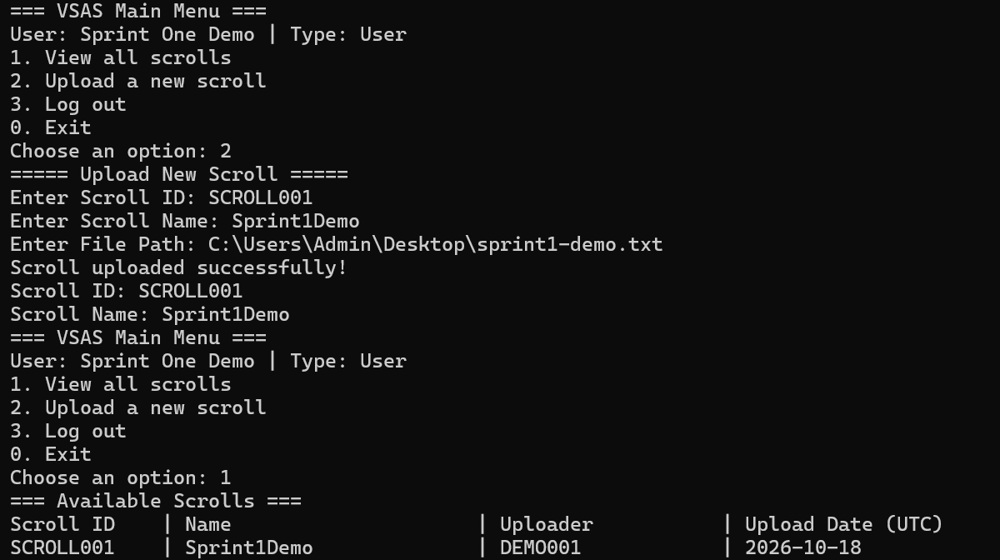
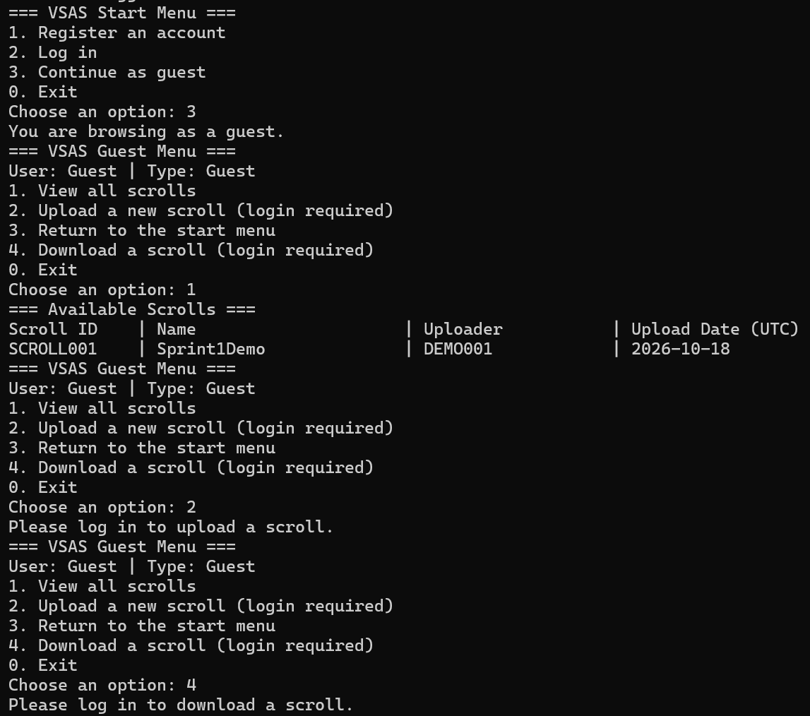
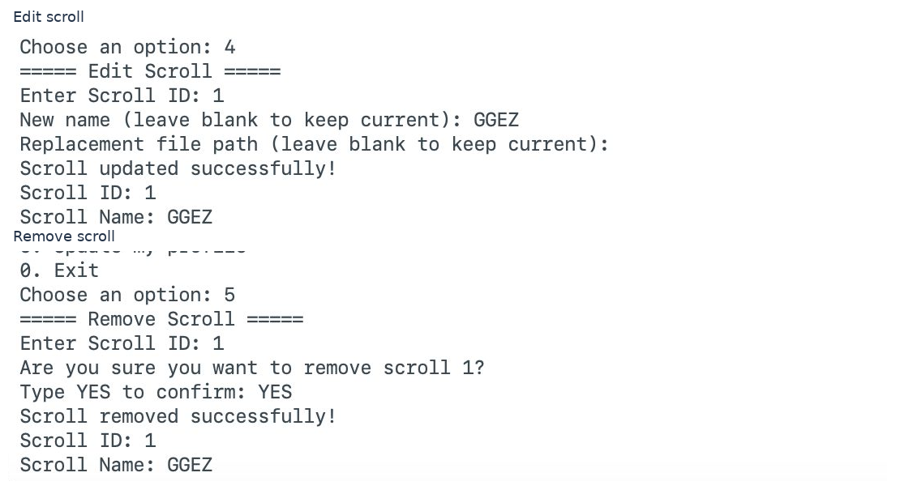
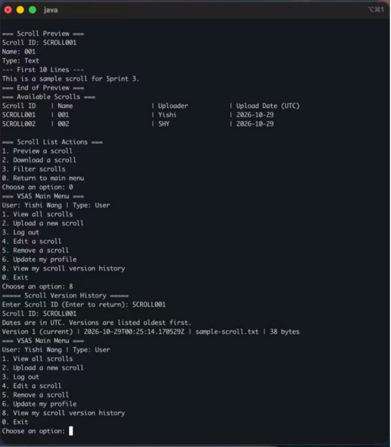
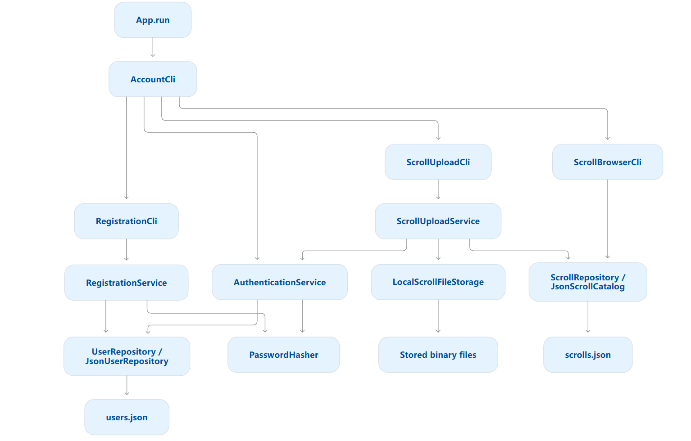
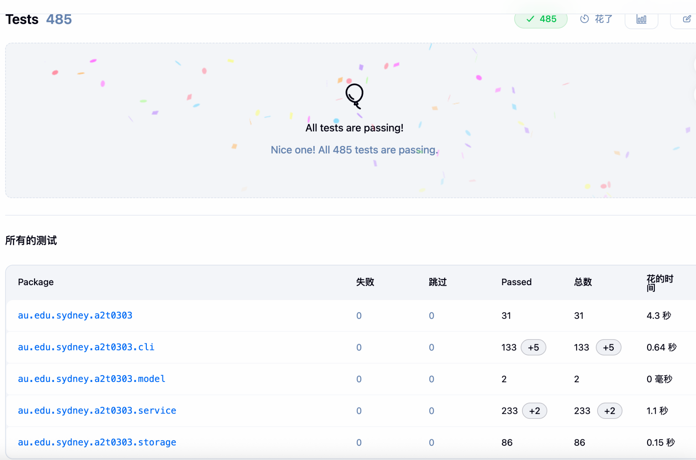
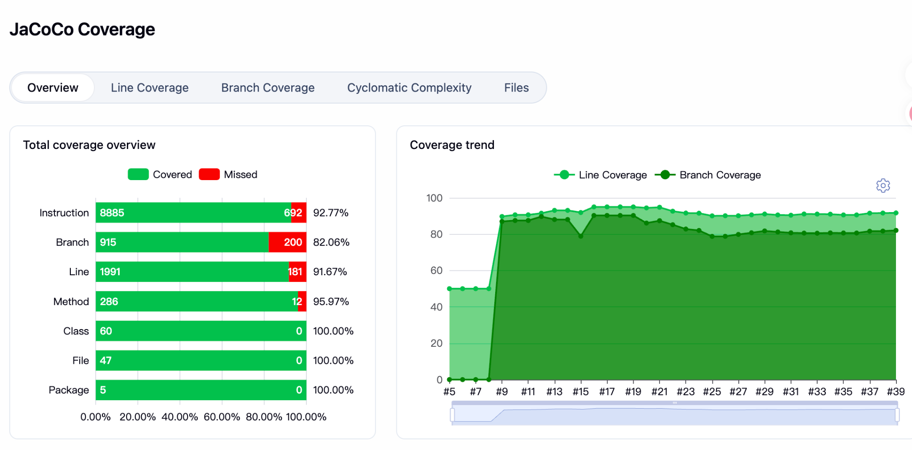

# VSAS — Virtual Scroll Access System（虚拟卷轴访问系统）

**Java 21 命令行程序 · 悉尼大学 SOFT2412 · 2026 年 10 月 · 四人课程团队项目**

VSAS 是一款通过终端操作的数字文件管理系统。用户可以把本地文件上传为“Scroll（卷轴）”，并根据身份权限浏览、搜索、预览、下载、编辑和删除文件。三轮 Scrum Sprint 逐步增加了版本历史、静态数据加密、账号锁定和自动化测试。

> **关于这个展示仓库：** 已包含真实 Java 源码、JUnit 测试、Gradle/Jenkins 配置以及课程报告中的代表性截图。它不是可在线访问的网页，也不是生产环境软件。完整课程报告、内部会议资料和个人信息没有随代码公开；系统功能由四人团队合作完成。

## 项目截图

### 文件上传与浏览

登录用户可填写卷轴 ID、名称和本地文件路径上传文件，并查看列表。



### 游客访问控制

游客可浏览目录，但上传和下载需要登录。



### 编辑与删除

Sprint 2 演示中的命令行截图节选，展示修改卷轴及删除前必须输入大写 `YES` 的确认过程。



### 文件历史版本

Sprint 3 演示展示文本预览与持久化版本历史。此截图截取自最终团队报告。



### 初期系统架构

Sprint 1 将 CLI 交互层、业务逻辑层、仓储接口和 JSON／二进制持久化层分开；后续增加版本管理和加密服务。



## 团队实现的功能

- **账号与权限：** 注册、登录、游客浏览、修改资料、管理员管理账号、失败登录锁定与解锁。
- **文件管理：** 上传、列表浏览、搜索筛选、文本／二进制预览、指定目录下载、编辑替换、删除、历史版本。
- **数据与安全：** JSON 元数据、二进制文件存储、PBKDF2 加盐密码哈希、权限控制、最终迭代中的 AES-256-GCM 文件静态加密。
- **工程实践：** Java 21、Gradle、Shadow 可执行 JAR、JUnit、JaCoCo、Jenkins、GitHub PR 和 Scrum。

## 我的个人贡献 — Shuai Wang

以下是由 Sprint 报告和对应任务/PR 支持的个人工作，未将其他成员负责的功能归为个人成果：

- **Sprint 1，US04：** 负责文件上传，实现卷轴 ID／名称唯一性、文件路径与内容校验、二进制存储及上传元数据，并编写相应测试。
- **Sprint 2，US08／US09：** 负责文件编辑／替换与删除，处理所有者和管理员权限、删除确认，以及配套的数据层变更（PR #52、#54、#55）。
- **Sprint 3，PR #67：** 优化下载交互，让用户选择目标文件夹，保留原始文件名，并处理目标文件名冲突。
- **Sprint 3，PR #71：** 优化编辑与下载操作中的 Scroll ID 输入验证，提前拦截无效 ID，避免无意义的后续提示。
- **团队协作：** 参与代码评审和集成；担任 Sprint 3 Scrum Master，协调进度、准备展示和整理报告。

版本历史、加密、账号锁定、管理员功能和可执行包等属于团队共同成果，其中部分功能由其他成员主导。

## 如何运行源码

**环境：** JDK 21；无需单独安装 Gradle（包含 Gradle Wrapper）。首次构建通常需要网络下载 Gradle 与依赖。此展示包的源码尚未在当前环境重新编译测试。

在仓库根目录执行：

```bash
# macOS / Linux
./gradlew clean :app:build :app:jacocoTestReport
java -jar app/build/libs/vsas-all.jar demo-data
```

Windows PowerShell：

```powershell
.\gradlew.bat clean :app:build :app:jacocoTestReport
java -jar .\app\build\libs\vsas-all.jar demo-data
```

`demo-data` 是本地演示数据文件夹；缺省为 `data`。不要上传运行时生成的账号文件、卷轴文件或加密密钥。请用独立的测试数据运行。

**重要限制：** 原始课程源码中含有硬编码的初始演示管理员凭据，不能直接作为公网服务部署。这里保留原始代码供审阅，并明确标注为教学原型；如用于正式系统，需要重新设计管理员初始化与安全配置。

## 测试与覆盖率记录

Sprint 3 最终报告记录了 **2026 年 10 月 29 日 Jenkins 构建 #39**：**485 项测试通过，0 失败、0 跳过**，JaCoCo **行覆盖率 91.67%／分支覆盖率 82.06%**。这是团队报告中的真实构建记录，并非本次导出时重新执行的测试结果。





## 文件结构

```text
app/src/main/java/    Java 主程序（CLI／业务服务／模型／存储）
app/src/test/java/    JUnit 自动化测试源码
app/build.gradle      编译、依赖、测试与 JaCoCo／Shadow 配置
Jenkinsfile           Jenkins CI 流水线
settings.gradle       Gradle 工程配置
gradle/ 和 gradlew    Gradle Wrapper
screenshots/          课程演示和测试截图
```

## 来源及公开说明

本展示版整理自四人团队的最终 `main` 分支 ZIP，截图取自 Sprint 1–3 团队课程报告。未包含原始 Git 提交历史、内部会议记录、完整课程报告、学生学号、签名、聊天记录、账号数据库、上传文件和密钥。代码中包括所有贡献者的工作；学校 PR 可能要求悉尼大学登录。公开前须确认课程规定及所有相关贡献者的授权。
